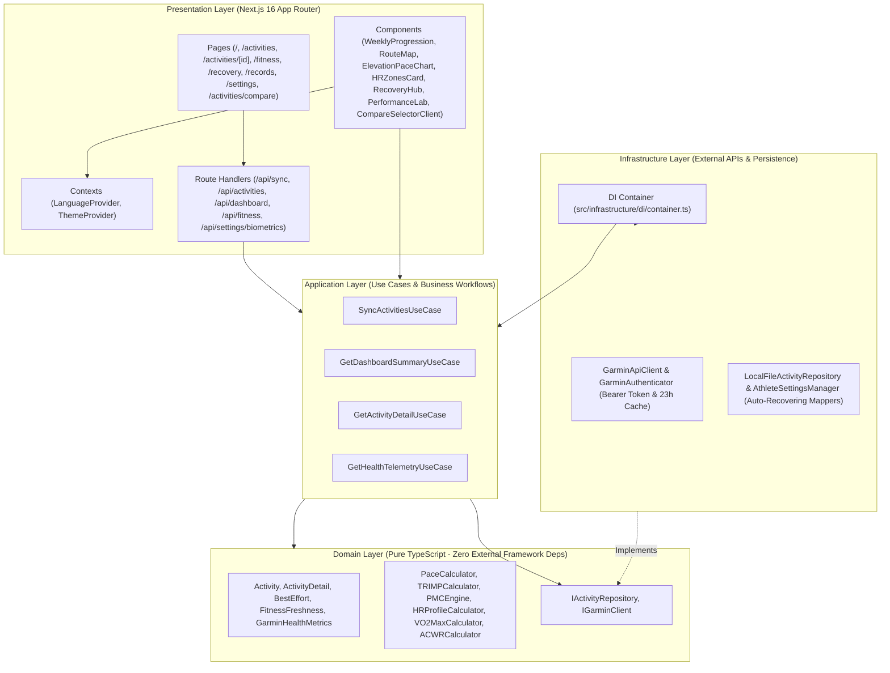

# 🏃 FREEDAYZZ // PULSE (ADVANCED RUNNING TELEMETRY LAB)
> **The Most Comprehensive All-in-One Running Analytics Dashboard & Physiological Telemetry Platform**

[](https://nextjs.org/)
[](https://react.dev/)
[](https://www.typescriptlang.org/)
[](https://turbo.build/pack)
[](https://tailwindcss.com/)
[](https://leafletjs.com/)
[](#architecture)

---

## ⚡ Quick Access & Live Server

The application is actively running on the local development server:
- **Local URL**: [http://localhost:3000](http://localhost:3000)
- **Aesthetic Themes**:
  - **Cyber Obsidian (Dark Mode)**: Deep Obsidian `#06070d`, Cyber Navy `#0d1224`, Electric Violet `#7c3aed`, Pulse Orange `#f97316`, and functional telemetry accents.
  - **Athletic Slate (Light Mode)**: Crisp athletic paper aesthetic (`#f6f8fc`), clean cards (`#ffffff`), slate ink typography (`#0f172a`), CartoDB Positron maps, and pastel telemetry badges.

---

## 🎯 Platform Capabilities & Core Features

| Feature Area | Route | Description & Telemetry Insights |
| :--- | :--- | :--- |
| **Executive Running Dashboard** | [`/`](file:///c:/project/running-dashboard-analytics/src/app/page.tsx) | **Rolling Weekly Progression**: Interactive 12-week area chart with touch/hover synchronization. Sports filters (*All Sports, Run, Weight Training*). 1-click **Export Month in Sport PNG** graphic. Dynamic Garmin weekly streak with 28-day active dot matrix. |
| **Acute:Chronic Workload Ratio (ACWR)** | [`/`](file:///c:/project/running-dashboard-analytics/src/app/page.tsx) | **Injury Risk Prevention Index**: Ratio of Acute 7-Day Load vs Chronic 28-Day Load (Sweet Spot: `0.8 - 1.3`, High Risk: `> 1.5`). |
| **Training Log Volume Calendar** | [`/`](file:///c:/project/running-dashboard-analytics/src/app/page.tsx) | **Visual 6-Week Volume Calendar**: Monday-to-Sunday weekly grid where bubble diameter scales proportionally with mileage (e.g. 5km vs 11km). Color-coded by volume/intensity with exact day telemetry drill-down. |
| **Fitness & Freshness (Coggan PMC)** | [`/fitness`](file:///c:/project/running-dashboard-analytics/src/app/fitness/page.tsx) | **Physiological Impulse-Response Engine**: Tracks **Fitness (CTL 42-day base)**, **Fatigue (ATL 7-day debt)**, and **Form (TSB balance)**. Classifies training state into *Peaking / Race Ready*, *Fresh & Recovered*, *Optimal Overload*, *Productive Fatigue*, and *Overreaching Risk*. |
| **Garmin Cardio Recovery & HRV Hub** | [`/recovery`](file:///c:/project/running-dashboard-analytics/src/app/recovery/page.tsx) | **Hardware-Grade Biometrics**: Jack Daniels VDOT & Race Predictor (5K, 10K, Half Marathon, Full Marathon). Overnight HRV Status (Balanced vs Low) with 30-day baseline ranges. Body Battery energy recharge. 7-Day Physiological Trends (RHR, HRV, Body Battery, Sleep Duration with 7h goal line). Dedicated Sleep Score Drill-Down (Firstbeat Sleep Score, In-Bed vs Actual Asleep, Restless Awake, and 7-day sleep log). |
| **Personal Records (Best Efforts)** | [`/records`](file:///c:/project/running-dashboard-analytics/src/app/records/page.tsx) | **Strict Initial-Distance Benchmark Extraction**: Speed records for *1 Kilometer, 1 Mile, 5 Kilometers, 10 Kilometers, Half Marathon (21.1K), and Marathon (42.2K)*. Evaluated strictly from start (`0m` to target distance) without arbitrary middle-lap distortion. |
| **Head-to-Head Comparison Lab** | [`/activities/compare`](file:///c:/project/running-dashboard-analytics/src/app/activities/compare/page.tsx) | **Side-by-Side Run Benchmarks**: Compare any 2 runs with interactive **Monthly Calendar Date-Picker** and dropdown list. Multi-session day support (sorts primary workout first, displays all daily runs). Instant metrics delta (Pace, HR, Moving Time, Cadence, Stride Length, Vertical Ratio, GCT, TRIMP, Ambient Temp). Jitter-free selection with `{ scroll: false }`. |
| **Activity Telemetry & Performance Lab** | [`/activities/[id]`](file:///c:/project/running-dashboard-analytics/src/app/activities/[id]/page.tsx) | **Freedayzz Performance Lab**: Pacing execution strategy (Negative split vs Positive split), Grade Adjusted Pace (GAP), Aerobic Decoupling (Pw:HR cardiac drift), ambient weather & heat stress (`minTemperature`, `maxTemperature`), and GPX route export. |
| **Interactive Satellite Route Map** | [`/activities/[id]`](file:///c:/project/running-dashboard-analytics/src/app/activities/[id]/page.tsx) | **Leaflet Dark Matter / Positron**: Theme-adaptive mapping with CartoDB Dark Matter (Dark mode) and CartoDB Positron (Light mode). Neon GPS polylines, start/finish flag waypoints, and synchronized elevation/pace telemetry crosshair hover. |
| **Kilometer Splits & Pacing Efficiency** | [`/activities/[id]`](file:///c:/project/running-dashboard-analytics/src/app/activities/[id]/page.tsx) | **Per-Kilometer Moving Telemetry Table**: Split distance, duration, moving pace, elevation delta (+/- m), average heart rate, and cadence with modal drill-down. |
| **Garmin Running Dynamics** | [`/activities/[id]`](file:///c:/project/running-dashboard-analytics/src/app/activities/[id]/page.tsx) | **Advanced Biomechanics**: Ground Contact Time (ms), Vertical Oscillation (cm), Stride Length (m), and Vertical Ratio (%) with Stride Efficiency Index. |
| **Athlete Profile & Preferences** | [`/settings`](file:///c:/project/running-dashboard-analytics/src/app/settings/page.tsx) | **Preferences & Biometrics**: Language dropdown (`EN` | `ID`), Theme dropdown (`dark` | `light`). Resting HR auto-synced from Garmin 7-Day Average (`52 BPM`). Max HR user-calibrated with Karvonen Heart Rate Reserve (%HRR) brackets. |

---

## 🌐 Localization & Theme Engine

### 1. Bilingual Architecture (`EN` | `ID`)
- Built with React Context (`LanguageProvider` and `useLanguage()`) and typed dictionary mapping in `src/context/translations.ts`.
- Supported Languages:
  - **`EN`**: English (Default international running telemetry terminology)
  - **`ID`**: Bahasa Indonesia (Localized Indonesian sports metrics and physiological labels)
- Managed directly in **Settings > Preferences & Localization** via clean dropdowns.
- Stored and persisted in browser `localStorage` (`freedayzz_lang`).

### 2. High-Contrast Theme Engine (`dark` | `light`)
- Dual-palette styling in `src/app/globals.css`:
  - **`dark` (Default)**: Deep Cyber Obsidian with neon violet and pulse orange accents.
  - **`light`**: Crisp Athletic Slate with high-contrast slate ink, clean card borders, and CartoDB Positron maps.
- Anti-flash inline hydration script in `src/app/layout.tsx` guarantees zero visual flicker on initial load.
- Seamlessly switches Leaflet map tiles between CartoDB Dark Matter and CartoDB Positron.

---

## 📅 Compare Runs Calendar Date-Picker

To simplify finding and comparing activities across dozens or hundreds of sessions:
1. Navigate to `/activities/compare`.
2. Toggle **`[📅 CALENDAR PICKER]`**:
   - Monthly Mon-Sun grid showing days with completed workouts.
   - Days with sessions display glowing mileage pills (`11.0k`, `5.0k`).
   - If multiple workouts occurred on the same day (e.g. Oct 22 with an 11K main run and a 0.2K shakeout), the day prioritizes the main workout by distance and displays a `2x` badge.
   - Clicking a day reveals the **Session Assignment Tray** showing all sessions for that date.
   - Assign to **RUN A** or **RUN B** with a single click.
   - Viewport scroll position is locked (`{ scroll: false }`) so the screen stays stable without jumping to the top!

---

## 🏛️ Clean Architecture Codebase

The system is architected under **Clean Architecture** principles with strict dependency boundaries:



---

## 🔬 Core Algorithms & Physiological Models

### 1. Benchmark & PR Milestone Calculation (Strict Initial Distance)
* To prevent rolling sprint distortions from later laps (e.g. lap 2 downhill sprints being falsely recorded as 1K PRs), all milestone splits are derived strictly from **start (`0m`) to target distance (`1,000m`, `1,609.34m`, `5,000m`, `10,000m`, etc.)**.
* Pacing strictly prioritizes active moving time (`sumMovingDuration`) to exclude idle pauses.

### 2. Bannister TRIMP & Coggan Performance Management Chart (PMC)
* **Relative Effort (TRIMP)**:
  $$\text{TRIMP} = D \times \Delta\text{HR}_{\text{ratio}} \times 0.64 \times e^{1.92 \times \Delta\text{HR}_{\text{ratio}}}$$
  Where $\Delta\text{HR}_{\text{ratio}} = \frac{\text{HR}_{\text{avg}} - \text{HR}_{\text{rest}}}{\text{HR}_{\text{max}} - \text{HR}_{\text{rest}}}$ and $D$ is moving duration in minutes.
* **Fitness (CTL)**: $42$-day exponential moving average.
* **Fatigue (ATL)**: $7$-day exponential moving average.
* **Form (TSB)**: $\text{TSB} = \text{CTL} - \text{ATL}$.

### 3. Acute:Chronic Workload Ratio (ACWR)
* Compares acute strain (7-day load) against chronic preparedness (28-day load).
* **Safe / Optimal Range**: `0.80` to `1.30`. High risk of overtraining or injury occurs when ACWR $> 1.50$.

### 4. Jack Daniels VDOT & Race Predictor
* Calibrated from your best 5K / 10K efforts using Daniels-Gilbert formula to compute VO2Max and predict 5K, 10K, Half Marathon, and Full Marathon finish times.

### 5. Firstbeat Sleep Score & Overnight HRV Telemetry
* Evaluates total in-bed sleep duration, actual time asleep, restless awake duration, and Body Battery nocturnal recharge.
* Integrated with Garmin Connect HRV status (7-day baseline, nightly average, and 5-min peak high).

---

## 🔄 Garmin Data Synchronization

To pull newly completed runs and health telemetry from your Garmin account:
1. Click the **`SYNC DATA`** button in the top navigation bar, or
2. Send a POST request to `/api/sync`:
   ```bash
   curl -X POST http://localhost:3000/api/sync -H "Content-Type: application/json" -d '{"force": true}'
   ```

Bearer tokens are automatically negotiated and cached for 23 hours to stay comfortably within Garmin Developer limits.
